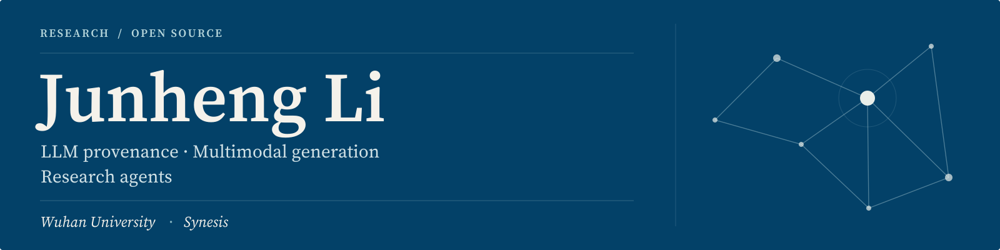

  

  <a href="mailto:lijunheng07@whu.edu.cn">Email</a> &nbsp;·&nbsp;
  <a href="https://synesis.cn">Synesis</a> &nbsp;·&nbsp;
  <a href="#selected-research">Research</a> &nbsp;·&nbsp;
  <a href="#research-systems--open-source">Open source</a>

I'm **Junheng Li (李俊亨)**, a Computer Science undergraduate in the **Lei Jun Class at Wuhan University**, and CEO of **Synesis**.

My research interests span **LLM provenance and black-box auditing**, **multimodal generation for education**, and **autonomous research agents**. I am interested in how models acquire behavior, how visual feedback can guide generation, and how research systems can connect ideas to testable evidence.

## Selected research

**Radioactive Feedback: Tracing Models Trained by Label-Only LLM Supervision**  
Second author · Preprint · 2026  
[Paper ↗](https://arxiv.org/abs/2610.15685) &nbsp;·&nbsp; [Code ↗](https://github.com/Kemalau/RadioactiveFeedBack)

Studies whether models trained on scalar LLM-judge feedback can be traced back to their supervisor. The method introduces keyed behavioral signals through reward feedback and tests for them through black-box audits.

**See Before You Code: Learning Visual Priors for Spatially Aware Educational Animation Generation**  
Third author · Preprint · 2026  
[Paper ↗](https://arxiv.org/abs/2605.15585) &nbsp;·&nbsp; [Code ↗](https://github.com/AI4Learning-Club/OmniManim)

Explores visual planning for educational animation generation: keyframe priors guide code generation, while rendered feedback supports spatial evaluation and local repair.

## Research systems & open source

### [AutoResearch · DeepGraph ↗](https://github.com/billion-token-one-task/Deepgraph)

**Team project · 1,000+ GitHub stars**

An autonomous research system connecting literature retrieval, evidence graphs, hypothesis generation, and experiment execution. The workflow turns research questions into budgeted experiments, then uses the resulting evidence to revise hypotheses and guide the next iteration.

### [Compressed Agent Communication ↗](https://github.com/Li-JunHeng/Embedding-MultiAgents)

**Research prototype · LLM multi-agent systems**

Experiments with compressed latent representations for communication between LLM agents. The repository explores slot-attention and other communication bottlenecks with a frozen LLM backbone, alongside benchmark and reproduction workflows.

---

<strong>中文简介</strong>

我是李俊亨，武汉大学计算机科学与技术（雷军班）本科生，Synesis 创始人兼 CEO。关注大语言模型溯源与黑盒审计、面向教育的多模态生成，以及自主科研智能体。

目前参与的研究包括 **Radioactive Feedback**（第二作者，预印本）与 **See Before You Code**（第三作者，预印本）。团队项目 **AutoResearch（DeepGraph）**围绕文献、证据图谱、假设与实验组织自动化科研流程，已获得 1,000+ GitHub stars；**Compressed Agent Communication** 则探索 LLM Agent 之间的压缩潜在表示通信。

欢迎通过 [lijunheng07@whu.edu.cn](mailto:lijunheng07@whu.edu.cn) 交流科研与合作。

